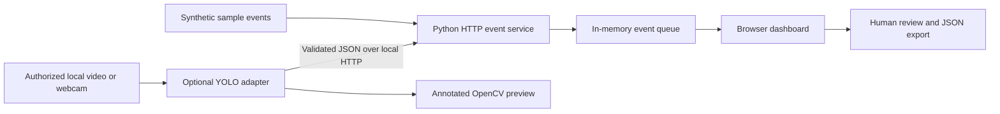
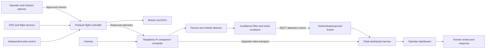
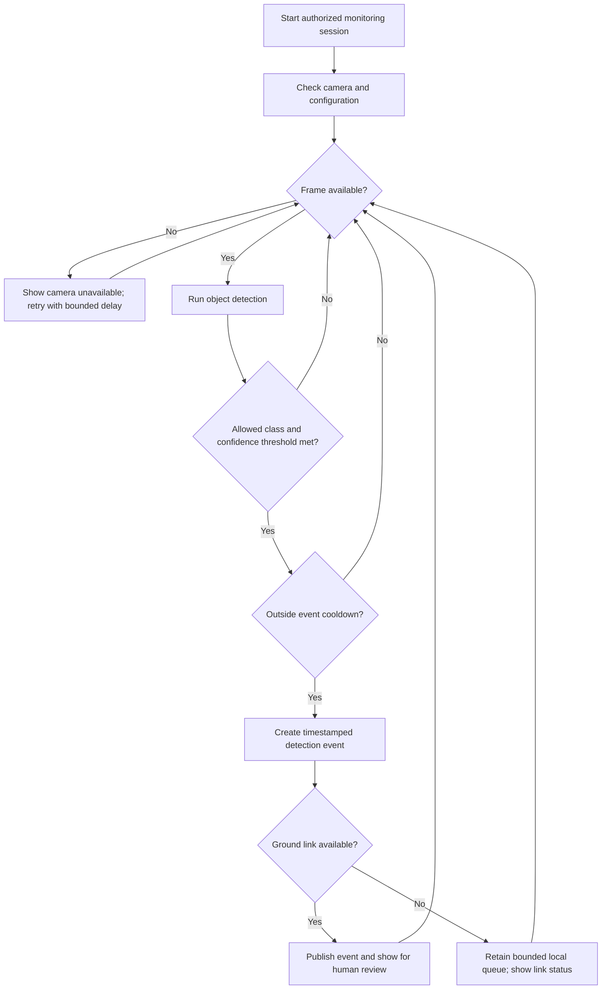

# Proposed architecture

## Implemented software path

Offline mode runs the same dashboard UI with browser-memory synthetic events. The optional detector requires third-party packages and local weights; inference has not been run in the restricted build environment. The implemented software does not command an aircraft.

## Proposed aircraft integration

The components below are future hardware design, not evidence of implementation.

The Pixhawk handles aircraft stabilization and configured flight failsafes. Camera processing, dashboard availability and alert delivery must not be prerequisites for maintaining stable flight. Telemetry integration and mission execution depend on the selected firmware and interface. This design does not include autonomous pursuit or identification of individuals.

## Processing flow

An object detection is not a threat assessment. If a restricted-zone rule is added later, document the zone, authorization, false-positive behavior and test cases separately.

## Interfaces

| Path | Proposed interface | Validation required |
| --- | --- | --- |
| Camera to companion | Camera driver / OpenCV capture | Frame timestamps, resolution, dropped frames |
| Flight controller to companion | Read-only telemetry over selected MAVLink transport | Units, message age, firmware compatibility |
| Companion to ground | MQTT over TLS | Authentication, delivery, duplicate handling |
| Camera video to dashboard | Separate transport, to be selected | Bandwidth, end-to-end delay, disconnect behavior |
| Dashboard to operator | Browser UI | Stale-state visibility, event history, human review |

MQTT carries small detection events, not the primary video stream. Video protocol, storage, retention and deployment details remain implementation decisions.
